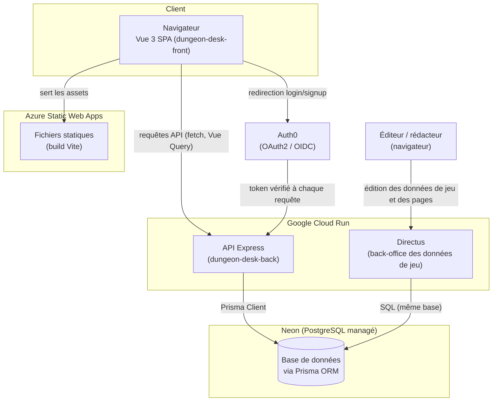

# Architecture logicielle

> **Mise à jour du 2026-10-19** — version en préparation (branche
> `feat/srd-database`, pas encore en production). Depuis la 1.0.0, les
> données de jeu (règles D&D 5e) ont quitté les fichiers JSON du front pour
> une base relationnelle éditée dans Directus, et le modèle des personnages
> a été entièrement refait. Les sections ci-dessous décrivent l'état actuel ;
> la section « Évolution depuis la 1.0.0 » résume ce qui a changé.

## Vue d'ensemble



Deux dépôts Git indépendants (`dungeon-desk-front`, `dungeon-desk-back`),
déployés séparément, communiquant uniquement par HTTP (API REST + OpenAPI).
Aucun code partagé entre les deux — le contrat d'API (voir plus bas) est la
seule interface commune.

Directus (back-office sans code) lit et écrit la même base que l'API : il
sert à corriger les données de jeu, à traduire et à rédiger les pages de
documentation sans passer par le code. Sa configuration (menus,
formulaires, rôles) est elle-même versionnée sous forme de script
(`dungeon-desk-back/src/directus/`). Le déploiement de Directus en
production fait partie de la mise en production à venir.

## Frontend (`dungeon-desk-front`)

SPA Vue 3 servie en statique depuis Azure Static Web Apps (voir
[protocole-cicd.md](./protocole-cicd.md)). Structure de `src/` :

| Dossier | Rôle |
|---|---|
| `views/` | Une vue par route (`CharacterCreator.vue`, `CharacterSheetView.vue`, `BestiaryView.vue`, `CampaignView.vue`, `RulesView.vue`...), chargée à la demande (sauf l'accueil) |
| `components/` | Composants réutilisables : `CreateCharacterSteps/` (8 étapes), `sheet/` (fiche de personnage), `campaign/`, `guide/`, `bestiary/`, `profile/`... |
| `stores/` | État global Pinia — 3 stores : `auth.ts`, `character.ts`, `npc.ts` |
| `composables/` | Logique réutilisable hors état global (`useDiceRoller.ts`, `useChoicePreview.ts`, `useCampaignItemForm.ts`...) |
| `utils/` | Fonctions pures : `dataLoader.ts` (lecture des données de jeu par l'API), mise en forme (`spellFormat.ts`, `monsterFormat.ts`), rendu Markdown nettoyé (`markdown.ts`), générateur de PNJ, actions de la fiche |
| `api/generated/` | Client HTTP + types générés par Orval (voir plus bas) — **jamais modifié à la main** |
| `api/campaigns.ts` | Client des routes de campagne, écrit à la main (voir « Limites connues ») |
| `router/` | Déclaration des routes (`src/router/index.ts`) |
| `types/` | Types partagés (`Character`, format d'échange avec l'API) |

Le front ne contient plus aucune donnée de jeu : races, classes, sorts,
monstres, règles, textes de documentation viennent tous de l'API
(`/api/srd/:edition/…`), traduits dans la langue demandée.

## Backend (`dungeon-desk-back`)

API Express déployée en conteneur sur Cloud Run. Séparation en couches
inspirée du pattern MVC (détaillée dans
[frameworks-paradigmes.md](./frameworks-paradigmes.md)) :

```
src/
├── routes/        # déclaration des endpoints + doc Swagger inline (personnages, PNJ, campagnes, données SRD)
├── controllers/   # logique par ressource (character, npc, campaign, srd*)
├── characters/    # moteur de règles des personnages : validation, fiche calculée (pur, testé sans base)
├── campaigns/     # difficulté des rencontres (Guide du maître 2014, pur)
├── validators/    # schémas Zod des entrées (PNJ, campagnes)
├── middleware/    # protect (Auth0), validateIdParam
├── srd/           # langue des réponses, schémas Zod des colonnes JSONB
├── seed/          # import des données du SRD dans la base (npx prisma db seed)
├── directus/      # configuration du back-office (npm run directus:config)
├── utils/         # logger (Winston), monitoring (Prometheus)
└── swagger/       # génération de la spec OpenAPI
```

Chaque route passe par : `middleware` (authentification/validation légère)
→ `controller` (validation Zod + accès Prisma) → réponse JSON. Pour les
personnages, le contrôleur délègue à `src/characters/` : le client envoie
toujours le personnage complet (format d'échange : index des données de
jeu, `{ "race": "dwarf", "classes": [{ "class": "fighter", "levels": [...] }] }`),
le moteur de règles le valide contre les données de l'édition (choix
autorisés, multiclassage, sorts de la liste de classe...) et calcule la
fiche (CA, PV, emplacements de sorts, ressources). Ce moteur est une
fonction pure, testée sans base de données (`characterRules.test.ts`).

## Base de données

PostgreSQL managé (Neon), accédé via Prisma (et par Directus pour
l'édition). **149 tables**, réparties par domaine dans `prisma/schema/`
(référentiels, équipement, classes, races, sorts, monstres, objets
magiques, règles et guides, personnages, PNJ, campagnes). Détail des
tables, conventions et diagrammes :
`dungeon-desk-back/docs/modelisation/README.md`.

Principes :
- **Relationnel**, pas de JSON pour ce qui est référencé ou filtré : un
  personnage référence sa race, ses classes, ses sorts et ses objets par
  clé étrangère ; seules quelques valeurs neutres sans texte (vitesses,
  sens) sont en JSONB, validées par Zod.
- **Multi-édition** : chaque contenu de jeu porte son édition (`2014`,
  `2024` à venir).
- **Traductions séparées** : une table `<Entité>Translation` par entité ;
  l'API répond dans la langue demandée, avec repli sur la langue par défaut.
- **Données de jeu importées par un seed idempotent** depuis les fichiers
  du SRD (`prisma/data/`), puis éditables dans Directus.

## Ce qui favorise la maintenabilité

- **Typage TypeScript de bout en bout**, front et back, avec `strict` activé
  côté build (`vue-tsc --build` / `tsc --noEmit` bloquent la CI, voir
  [criteres-qualite-performance.md](./criteres-qualite-performance.md)).
- **Contrat d'API comme source unique de vérité** : le backend expose sa
  spec OpenAPI (`swagger-jsdoc`, exposée sur `/openapi.json` et `/api-docs`),
  et **Orval génère automatiquement** le client HTTP + les types + les hooks
  Vue Query côté frontend à partir de cette spec
  (`orval.config.ts` : `target: 'http://localhost:3000/openapi.json'`,
  sortie dans `src/api/generated/`, régénéré le 2026-10-19).
- **Règles métier en fonctions pures** (moteur des personnages, difficulté
  des rencontres, générateur de PNJ, mise en forme des fiches) : testables
  sans base ni navigateur, et réutilisées par plusieurs écrans.
- **Une seule source pour les données de jeu** : la base. Corriger une
  règle ou une traduction se fait dans Directus, sans redéployer le front.
- **Séparation claire des responsabilités** : les composants ne parlent
  jamais directement à Prisma — ils passent par les stores Pinia ou les
  clients d'API.

## Évolution depuis la 1.0.0

| 1.0.0 (juillet 2026) | Version en préparation (octobre 2026) |
|---|---|
| 3 modèles (`User`, `Character`, `Npc`) | 149 tables relationnelles |
| Personnage stocké en JSON (colonne `data`) | Personnage relationnel, validé par un moteur de règles |
| Données SRD en fichiers JSON dans `public/data` (8 Mo) | Données en base, servies par l'API, éditées dans Directus |
| 4 stores, dont `app.ts` (campagnes non branchées) | 3 stores ; campagnes réelles côté API |
| Authentification double (Auth0 + JWT interne) | Auth0 seul |

## Limites connues (assumées, pas cachées)

- **Client des campagnes écrit à la main** (`src/api/campaigns.ts`) alors
  que le reste passe par le client Orval : les routes de campagne ont été
  ajoutées avant que leurs schémas OpenAPI ne soient détaillés. Le client
  Orval contient désormais ces routes ; basculer dessus est une étape de
  nettoyage à faire.
- **Données de jeu en cache** côté API (`Cache-Control`, une heure ; une
  minute pour les pages de documentation) : une correction faite dans
  Directus n'apparaît pas immédiatement pour un visiteur qui a déjà chargé
  la page.
- **Directus pas encore en production** : son déploiement (Cloud Run,
  licence liée à l'adresse publique) est prévu avec la mise en production
  de cette version.
- **Colonne `password` de `User`** : vestige de l'ancienne authentification
  locale (supprimée le 2026-10-19), toujours présente en base mais plus
  remplie. À retirer par une migration ultérieure.
